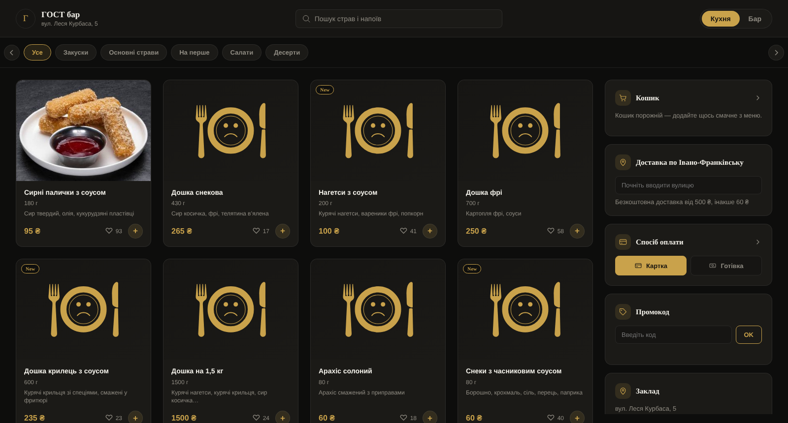
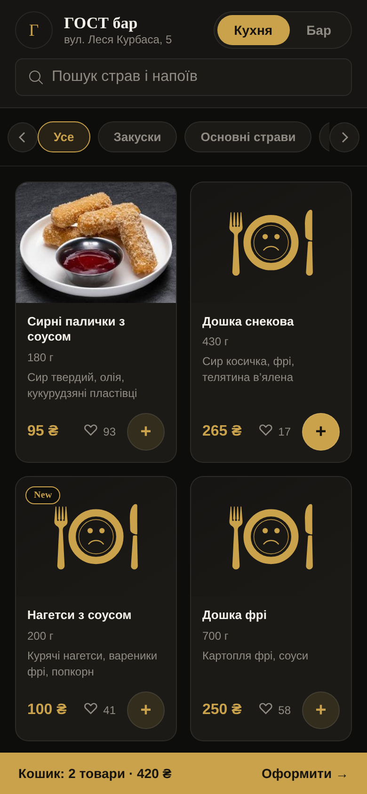
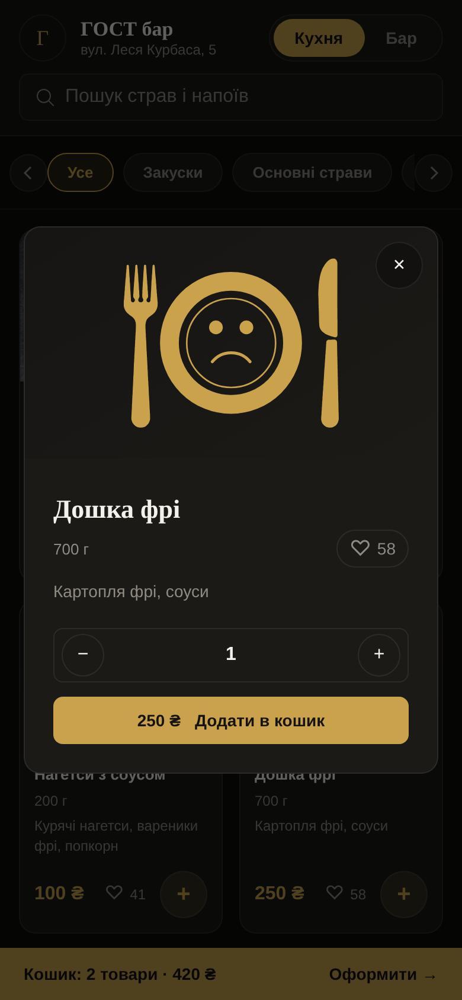
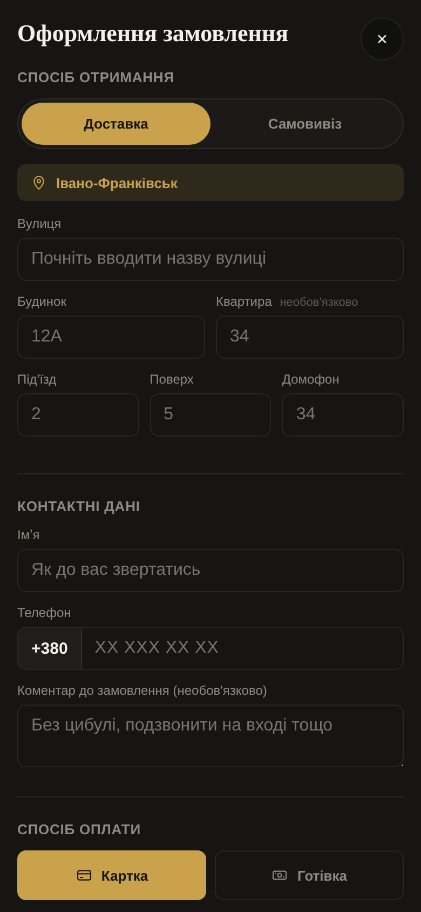

<div align="center">

# 🍻 GOST Bar — menu site with online ordering

**Catalog of dishes and drinks → cart → checkout → order saved in the database. With an admin panel.**




**🇬🇧 [English](#-english)** · **🇺🇦 [Українська](#-українська)**

</div>

---

# 🇬🇧 English

## Contents

- [Features](#features)
- [Screenshots](#screenshots)
- [Quick start](#quick-start)
- [Configuration](#configuration)
- [Admin panel](#admin-panel)
- [Project structure](#project-structure)
- [API](#api)
- [Security](#security)
- [Known limitations](#known-limitations)
- [Roadmap](#roadmap)
- [Note about the data](#note-about-the-data)

## Features

**For visitors**

- 🍽️ Menu with **Kitchen / Bar** sections, categories, search by name (300 ms debounce)
- 🛒 Cart that survives a page reload (`localStorage`): quantity, removal, promo code
- 🚚 Progress bar to free delivery (from 500 ₴) and a "Often ordered together" block
- 📍 Delivery **only within Ivano-Frankivsk**: street picked from suggestions, separate fields for house, apartment, entrance, floor and intercom; or pickup
- 📱 Phone (`+380`, operator code check) and name validation — on the frontend **and** on the server
- 💳 Pay by card (demo) or cash
- ❤️ **Likes**: a heart on the card and in the product window, counter stored in the DB, state kept between visits
- 📲 Responsive: sidebar cart on desktop, bottom bar and full-screen checkout on mobile (quantity can be changed or items removed there)

**For the owner**

- 🔐 Admin panel at `/admin/`: add, edit, hide and delete products, create categories, upload photos (compressed in the browser; the real JPEG signature is verified on the server)

**Under the hood**

- Prices, discounts and delivery are **always calculated by the server** — they cannot be tampered with from the browser
- All SQL queries are parameterized
- No native dependencies: the DB is Node.js's built-in `node:sqlite` module

## Screenshots

<table>
  <tr>
    <td align="center"><b>Catalog</b></td>
    <td align="center"><b>Product window</b></td>
    <td align="center"><b>Checkout</b></td>
  </tr>
  <tr>
    <td></td>
    <td></td>
    <td></td>
  </tr>
</table>

## Quick start

Requires **Node.js 22.5 or newer** (because of `node:sqlite`). Check with `node -v`. Tested on Linux and Windows 11 (macOS should work too — there are no native dependencies).

```sh
git clone https://github.com/07NORTH07/gost-bar-site.git
cd gost-bar-site

npm install        # dependencies: express, helmet, express-rate-limit
npm run seed       # creates the DB and fills it with a demo menu and promo codes
npm start          # http://localhost:3000
```

For development with auto-restart: `npm run dev`.

Scripts:

| Command | What it does |
| --- | --- |
| `npm start` | starts the server |
| `npm run start:env` | same, but reads variables from the `.env` file |
| `npm run dev` | starts with auto-restart (`node --watch`) |
| `npm run seed` | fills the DB with demo data. Refuses to run if products already exist (so your data isn't wiped); to reset on purpose: `node server/database/seed.js --force` |
| `node server/database/import-streets.js` | one-time download of the full list of Ivano-Frankivsk streets from OpenStreetMap (needs internet); without it, a short built-in list is used |

**Try it:** add items to the cart, enter promo code `GOST10` (−10 %) or `WELCOME15` (−15 %), place an order.

## Configuration

An example is in [`.env.example`](.env.example). Copy it to `.env` (this file never reaches git) and run `npm run start:env`:

```sh
cp .env.example .env     # then edit .env
npm run start:env
```

| Variable | Default | Purpose |
| --- | --- | --- |
| `PORT` | `3000` | server port |
| `ADMIN_PASSWORD` | random on every start (printed to the console) | admin panel password |
| `TRUST_PROXY` | off (enabled automatically on Render) | set to `1` if the site is behind a reverse proxy, so rate limits use the client's real IP |

One-off password without a file: `ADMIN_PASSWORD='my-password' npm start` (bash/zsh) or `env ADMIN_PASSWORD='my-password' npm start` (fish).

**Windows:**

```bat
:: cmd
copy .env.example .env
set ADMIN_PASSWORD=my-password && npm start
```

```powershell
# PowerShell
Copy-Item .env.example .env
$env:ADMIN_PASSWORD='my-password'; npm start
```

If PowerShell complains that running scripts is disabled, use `cmd` or run `Set-ExecutionPolicy -Scope CurrentUser RemoteSigned`.

> ⚠️ If you deploy this anywhere public, **always set your own `ADMIN_PASSWORD`**.

## Admin panel

URL: `http://localhost:3000/admin/`. Log in with the password from `ADMIN_PASSWORD`; after 8 failed attempts in 15 minutes, login is temporarily blocked. A session lasts 12 hours and is kept in server memory (you have to log in again after a restart).

## Project structure

```text
gost-bar-site/
├── server/
│   ├── server.js                 # entry point: helmet, limits, routes, error handling
│   ├── middleware/
│   │   └── client-id.js          # anonymous cookie for likes
│   ├── routes/
│   │   ├── categories.js         # GET  /api/categories
│   │   ├── products.js           # GET  /api/products, likes (PUT/DELETE .../like)
│   │   ├── orders.js             # POST /api/orders, GET /api/orders/:token
│   │   ├── promo.js              # GET  /api/promo/:code
│   │   ├── streets.js            # GET  /api/streets?q=
│   │   └── admin.js              # /api/admin/* (login, products, categories, photos)
│   └── database/
│       ├── schema.sql            # DB schema
│       ├── db.js                 # SQLite connection, migrations on start
│       ├── seed.js               # demo data
│       ├── import-streets.js     # street import from OpenStreetMap
│       └── streets-fallback.json # starter street list
├── public/
│   ├── index.html                # site page
│   ├── css/style.css             # styles and design tokens
│   ├── js/
│   │   ├── api.js                # fetch wrapper
│   │   ├── cart.js               # cart (localStorage + pub/sub)
│   │   └── app.js                # catalog, modal, cart, checkout, likes
│   ├── assets/icons/             # icons
│   └── admin/                    # admin UI
├── docs/screenshots/             # images for this README
├── uploads/                      # product photos (created automatically, not in git)
├── .env.example                  # example settings
├── .gitignore
└── package.json
```

## API

**Public**

| Method | URL | Description |
| --- | --- | --- |
| `GET` | `/api/categories?section=kitchen\|bar` | categories |
| `GET` | `/api/products?section=&categoryId=&q=` | products (with a `liked` field for the current visitor) |
| `GET` | `/api/products/:id` | single product |
| `PUT` / `DELETE` | `/api/products/:id/like` | like / unlike → `{ liked, likesCount }` |
| `GET` | `/api/promo/:code` | check a promo code |
| `GET` | `/api/streets?q=` | street suggestions |
| `POST` | `/api/orders` | place an order → `{ orderId, orderToken, total, … }` |
| `GET` | `/api/orders/:token` | order by private token (not by number) |

**Admin** (header `Authorization: Bearer <token>`)

| Method | URL | Description |
| --- | --- | --- |
| `POST` | `/api/admin/login` | log in → `{ token }` |
| `GET` | `/api/admin/me` | check session |
| `GET` / `POST` | `/api/admin/categories` | list / new category |
| `GET` / `POST` | `/api/admin/products` | list / new product |
| `PUT` / `DELETE` | `/api/admin/products/:id` | update / delete a product |

## Security

What is in place:

- **Order privacy.** An order can only be read with a long random token (192 bits), not by a number that could be enumerated
- **Rate limits** per IP: orders, promo codes, likes, admin login
- **`helmet`**: protective HTTP headers and Content-Security-Policy
- **The server never trusts the client**: prices, discounts, delivery, quantities and availability are checked and calculated on the backend
- **SQL injection**: all queries are parameterized
- **XSS**: all dynamic text is escaped (including quotes in attributes)
- **Photos**: real JPEG signature check, size limit, protection against `../` on deletion
- **Admin**: constant-time password comparison, expiring token, password is not stored in code but read from an environment variable
- **Errors**: the client sees a short JSON message; stack traces stay in the server console
- **Secrets and customer data** never reach the repository: see `.gitignore` (`.env`, database, `uploads/`)

## Known limitations

This is a learning project, not a production-ready shop:

- 💳 **Card payment is a demo.** Card data is only validated in the form (mask, Luhn check, expiry) and is **never sent anywhere**; no money is charged, and a card order is immediately marked as paid. Real payments need an acquirer (LiqPay, WayForPay, Monobank)
- 🔑 The admin panel has one shared password and no roles
- 🧠 Admin sessions and rate-limit counters live in process memory (lost on restart, don't scale to several instances)
- 🔒 The server does not enable HTTPS itself — your host or reverse proxy must provide it
- 💾 SQLite and the `uploads/` folder live on disk. On free hosts with ephemeral disks (e.g. Render free) they disappear on every new deploy — an external DB and persistent storage for photos are needed
- ❤️ Likes are anonymous: clearing cookies lets you like again. Only the per-IP limit protects against mass inflation

## Roadmap

- [ ] Users with `ADMIN` / `MANAGER` roles (hashed passwords, logout)
- [ ] Order status management page in the admin panel
- [ ] Real payments through an acquirer
- [ ] External DB and photo storage + hosting deployment
- [ ] One-time promo codes and a minimum order amount

## Note about the data

The venue name, address and menu items in `seed.js` are for demonstration, collected from screenshots of a real venue for a learning project; this site is not affiliated with it and is not official. Product photos are not part of the repository — cards show the first letter of the name instead; real photos are added through the admin panel.

---

# 🇺🇦 Українська

## Зміст

- [Можливості](#можливості)
- [Скріншоти](#скріншоти)
- [Швидкий старт](#швидкий-старт)
- [Налаштування (змінні середовища)](#налаштування-змінні-середовища)
- [Адмінка](#адмінка)
- [Структура проєкту](#структура-проєкту)
- [API](#api-1)
- [Безпека](#безпека)
- [Відомі обмеження](#відомі-обмеження)
- [Плани](#плани)
- [Примітка щодо даних](#примітка-щодо-даних)

## Можливості

**Для відвідувача**

- 🍽️ Меню з розділами **Кухня / Бар**, категорії, пошук за назвою (debounce 300 мс)
- 🛒 Кошик, що переживає перезавантаження (`localStorage`): кількість, видалення, промокод
- 🚚 Прогрес до безкоштовної доставки (від 500 ₴) і блок «Часто беруть разом»
- 📍 Доставка **лише по Івано-Франківську**: вулиця обирається з підказок, окремі поля — будинок, квартира, під'їзд, поверх, домофон; або самовивіз
- 📱 Валідація телефону (`+380`, перевірка коду оператора) і ім'я — на фронті **та** на сервері
- 💳 Оплата карткою (демо) або готівкою
- ❤️ **Вподобання**: серце на картці й у вікні товару, лічильник у БД, стан зберігається між візитами
- 📲 Адаптив: на ПК — кошик у сайдбарі, на телефоні — нижня панель і повноекранне оформлення, де можна змінити кількість або прибрати товар

**Для власника**

- 🔐 Адмінка `/admin/`: додавання, редагування, приховування й видалення товарів, нові категорії, завантаження фото (стискається в браузері, на сервері перевіряється справжній підпис JPEG)

**Під капотом**

- Ціни, знижку й доставку **завжди рахує сервер** — підмінити їх із браузера неможливо
- Усі SQL-запити параметризовані
- Жодних native-залежностей: БД — вбудований у Node.js модуль `node:sqlite`

## Скріншоти

<table>
  <tr>
    <td align="center"><b>Каталог</b></td>
    <td align="center"><b>Вікно товару</b></td>
    <td align="center"><b>Оформлення</b></td>
  </tr>
  <tr>
    <td></td>
    <td></td>
    <td></td>
  </tr>
</table>

## Швидкий старт

Потрібен **Node.js 22.5 або новіший** (через `node:sqlite`). Перевірити: `node -v`. Перевірено на Linux і Windows 11 (на macOS теж має працювати — native-залежностей немає).

```sh
git clone https://github.com/07NORTH07/gost-bar-site.git
cd gost-bar-site

npm install        # залежності: express, helmet, express-rate-limit
npm run seed       # створює БД і наповнює її демо-меню та промокодами
npm start          # http://localhost:3000
```

Для розробки з автоперезапуском: `npm run dev`.

Скрипти:

| Команда | Що робить |
| --- | --- |
| `npm start` | запускає сервер |
| `npm run start:env` | те саме, але читає змінні з файлу `.env` |
| `npm run dev` | запуск з автоперезапуском (`node --watch`) |
| `npm run seed` | наповнює БД демо-даними. Якщо в БД уже є товари — відмовляється (щоб не стерти ваші); скинути свідомо: `node server/database/seed.js --force` |
| `node server/database/import-streets.js` | один раз завантажує повний список вулиць Івано-Франківська з OpenStreetMap (потрібен інтернет); без нього працює короткий вбудований список |

**Спробувати:** додайте товари в кошик, введіть промокод `GOST10` (−10 %) або `WELCOME15` (−15 %), оформіть замовлення.

## Налаштування (змінні середовища)

Приклад лежить у [`.env.example`](.env.example). Скопіюйте його в `.env` (цей файл у git не потрапляє) і запускайте `npm run start:env`:

```sh
cp .env.example .env     # потім відредагуйте .env
npm run start:env
```

| Змінна | За замовчуванням | Призначення |
| --- | --- | --- |
| `PORT` | `3000` | порт сервера |
| `ADMIN_PASSWORD` | випадковий на кожен запуск (друкується в консоль) | пароль до адмінки |
| `TRUST_PROXY` | вимкнено (на Render вмикається сам) | `1`, якщо сайт стоїть за reverse-proxy — тоді ліміти запитів рахуються по справжній IP клієнта |

Разова зміна пароля без файлу: `ADMIN_PASSWORD='мій-пароль' npm start` (bash/zsh) або `env ADMIN_PASSWORD='мій-пароль' npm start` (fish).

**Windows:**

```bat
:: cmd
copy .env.example .env
set ADMIN_PASSWORD=мій-пароль && npm start
```

```powershell
# PowerShell
Copy-Item .env.example .env
$env:ADMIN_PASSWORD='мій-пароль'; npm start
```

Якщо PowerShell пише, що виконання скриптів вимкнено, користуйтеся `cmd` або виконайте `Set-ExecutionPolicy -Scope CurrentUser RemoteSigned`.

> ⚠️ Якщо публікуєте сайт у мережі, **обов'язково задайте власний `ADMIN_PASSWORD`**.

## Адмінка

Адреса: `http://localhost:3000/admin/`. Вхід за паролем із `ADMIN_PASSWORD`; після 8 невдалих спроб за 15 хвилин вхід тимчасово блокується. Сесія живе 12 годин і лежить у пам'яті сервера (після перезапуску потрібно увійти знову).

## Структура проєкту

```text
gost-bar-site/
├── server/
│   ├── server.js                 # точка входу: helmet, ліміти, маршрути, обробка помилок
│   ├── middleware/
│   │   └── client-id.js          # анонімний cookie для вподобань
│   ├── routes/
│   │   ├── categories.js         # GET  /api/categories
│   │   ├── products.js           # GET  /api/products, вподобання (PUT/DELETE .../like)
│   │   ├── orders.js             # POST /api/orders, GET /api/orders/:token
│   │   ├── promo.js              # GET  /api/promo/:code
│   │   ├── streets.js            # GET  /api/streets?q=
│   │   └── admin.js              # /api/admin/* (вхід, товари, категорії, фото)
│   └── database/
│       ├── schema.sql            # схема БД
│       ├── db.js                 # підключення SQLite, міграції при старті
│       ├── seed.js               # демо-дані
│       ├── import-streets.js     # імпорт вулиць з OpenStreetMap
│       └── streets-fallback.json # стартовий список вулиць
├── public/
│   ├── index.html                # сторінка сайту
│   ├── css/style.css             # стилі й дизайн-токени
│   ├── js/
│   │   ├── api.js                # обгортка над fetch
│   │   ├── cart.js               # кошик (localStorage + pub/sub)
│   │   └── app.js                # каталог, модалка, кошик, оформлення, вподобання
│   ├── assets/icons/             # іконки
│   └── admin/                    # інтерфейс адмінки
├── docs/screenshots/             # картинки для цього README
├── uploads/                      # фото товарів (створюється сама, у git не потрапляє)
├── .env.example                  # приклад налаштувань
├── .gitignore
└── package.json
```

## API

**Публічне**

| Метод | Адреса | Опис |
| --- | --- | --- |
| `GET` | `/api/categories?section=kitchen\|bar` | категорії |
| `GET` | `/api/products?section=&categoryId=&q=` | товари (з полем `liked` для поточного відвідувача) |
| `GET` | `/api/products/:id` | один товар |
| `PUT` / `DELETE` | `/api/products/:id/like` | поставити / зняти сердечко → `{ liked, likesCount }` |
| `GET` | `/api/promo/:code` | перевірка промокоду |
| `GET` | `/api/streets?q=` | підказки вулиць |
| `POST` | `/api/orders` | оформити замовлення → `{ orderId, orderToken, total, … }` |
| `GET` | `/api/orders/:token` | замовлення за приватним токеном (не за номером) |

**Адмінка** (заголовок `Authorization: Bearer <token>`)

| Метод | Адреса | Опис |
| --- | --- | --- |
| `POST` | `/api/admin/login` | вхід → `{ token }` |
| `GET` | `/api/admin/me` | перевірка сесії |
| `GET` / `POST` | `/api/admin/categories` | список / нова категорія |
| `GET` / `POST` | `/api/admin/products` | список / новий товар |
| `PUT` / `DELETE` | `/api/admin/products/:id` | зміна / видалення товару |

## Безпека

Що зроблено:

- **Приватність замовлень.** Замовлення читається лише за довгим випадковим токеном (192 біти), а не за номером, який можна перебрати
- **Ліміти запитів** за IP: оформлення замовлень, промокоди, вподобання, вхід в адмінку
- **`helmet`**: захисні HTTP-заголовки та Content-Security-Policy
- **Сервер не довіряє клієнту**: ціни, знижки, доставка, кількість і наявність товарів перевіряються й рахуються на бекенді
- **SQL-ін'єкції**: усі запити параметризовані
- **XSS**: увесь динамічний текст екранується (включно з лапками в атрибутах)
- **Фото**: перевірка справжнього підпису JPEG, обмеження розміру, захист від `../` при видаленні
- **Адмінка**: порівняння пароля за сталий час, токен із терміном дії, пароль не зберігається в коді — береться зі змінної середовища
- **Помилки**: клієнт бачить коротке JSON-повідомлення, стек і деталі лишаються в консолі сервера
- **Секрети й дані клієнтів** не потрапляють у репозиторій: див. `.gitignore` (`.env`, база даних, `uploads/`)

## Відомі обмеження

Це навчальний проєкт, а не готовий до продакшену магазин:

- 💳 **Оплата карткою — демонстрація.** Дані картки лише перевіряються у формі (маска, алгоритм Луна, термін дії) і **нікуди не надсилаються**; гроші не списуються, а замовлення з карткою одразу позначається оплаченим. Для реальної оплати потрібен еквайринг (LiqPay, WayForPay, Monobank)
- 🔑 В адмінці один спільний пароль без ролей
- 🧠 Сесії адмінки та лічильники лімітів лежать у пам'яті процесу (зникають при перезапуску, не масштабуються на кілька інстансів)
- 🔒 HTTPS сам сервер не вмикає — його має забезпечити хостинг або reverse-proxy
- 💾 SQLite і папка `uploads/` лежать на диску. На безкоштовних хостингах із тимчасовим диском (напр. Render free) вони зникають при новому розгортанні — потрібна зовнішня БД і постійне сховище для фото
- ❤️ Вподобання анонімні: очистивши cookie, можна поставити ще одне. Від масового накручування захищає лише ліміт за IP

## Плани

- [ ] Користувачі з ролями `ADMIN` / `MANAGER` (хешовані паролі, вихід із системи)
- [ ] Сторінка керування статусами замовлень в адмінці
- [ ] Реальна оплата через еквайринг
- [ ] Зовнішня БД і сховище для фото + публікація на хостингу
- [ ] Одноразові промокоди та мінімальна сума замовлення

## Примітка щодо даних

Назва закладу, адреса й позиції меню в `seed.js` — демонстраційні, зібрані зі скріншотів реального закладу для навчального проєкту; сайт із ним не пов'язаний і не є офіційним. Фото товарів у репозиторій не входять — на картках замість них перша літера назви; реальні фото додаються через адмінку.
